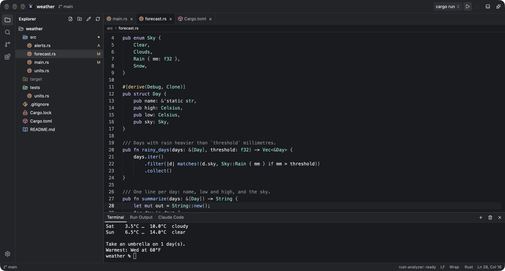
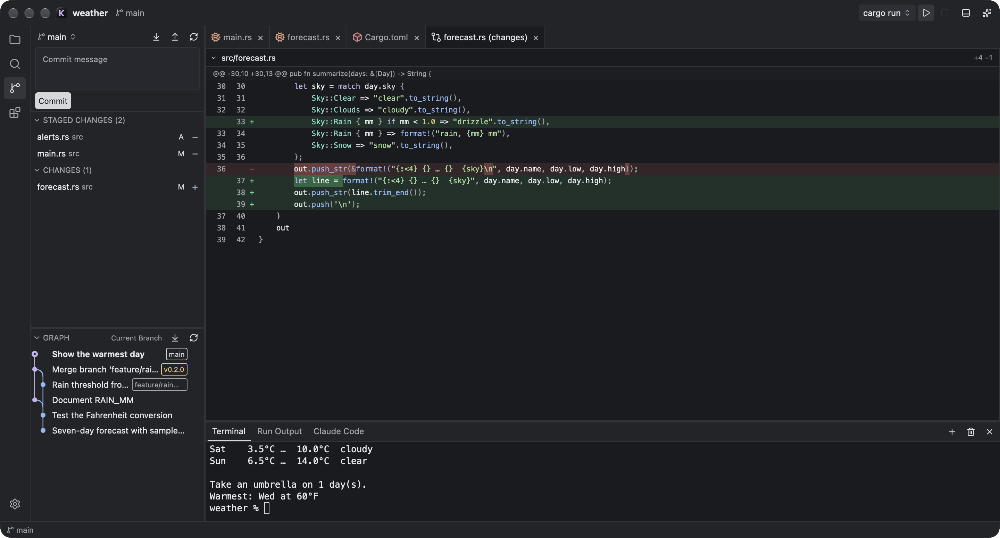
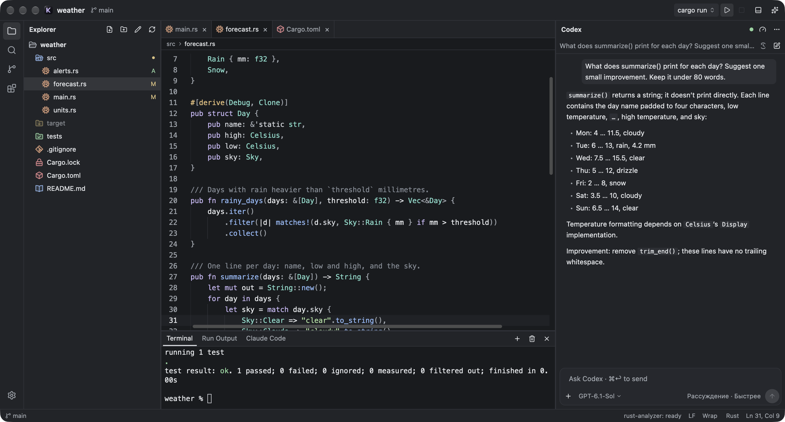

# KERN

KERN is a native code editor for macOS and Windows, built with Rust and GPUI.

**[Download for macOS](https://github.com/meytyy/kern/releases/download/v0.1.4/KERN-macos-arm64.zip)** (Apple Silicon) · **[Download for Windows](https://github.com/meytyy/kern/releases/download/v0.1.4/KERN-windows-x64-setup.exe)** (x64)



<table>
  <tr>
    <td></td>
    <td></td>
  </tr>
  <tr>
    <td align="center">Source Control, diff and commit graph</td>
    <td align="center">Codex in the side panel</td>
  </tr>
</table>

## What you can do

- **Edit code** with Tree-sitter highlighting for Rust, TypeScript and JavaScript, Python, Swift, C and C++, C#, HTML, CSS, JSON, YAML, TOML, Markdown, shell scripts and more. With a language server installed you get completions, hover, parameter hints, errors, Go to Definition and Format Document.
- **Find things**: open a file by name (⌘P / Ctrl+P), search the whole project (⇧⌘F / Ctrl+Shift+F) and run any command from the palette (⇧⌘P / Ctrl+Shift+P).
- **Work with files**: create, rename, move and trash them in the Explorer; preview images, video (macOS), archives and binary files.
- **Use Git**: stage and unstage, commit, see diffs, switch and create branches, pull, fetch and push, and browse the commit graph. Clone your GitHub repositories through the GitHub CLI (`gh`).
- **Run things**: an integrated terminal with tabs, and a Run button for Cargo, `package.json` scripts, Python, Swift and CMake projects.
- **Talk to Codex** in the side panel. It uses the official Codex app and your existing ChatGPT sign-in, and can take files and images as attachments.
- **Start Claude Code** in its own tab of the built-in terminal. It is the official `claude` CLI with its own sign-in and history.

KERN checks GitHub Releases for new versions. On Windows it installs the update itself; on macOS it opens the download.

## Install

**macOS** (Apple Silicon): unzip `KERN-macos-arm64.zip` and move `KERN.app` to Applications. The app is not notarized, so the first time open it from the context menu (**Open**) or allow it in System Settings → Privacy & Security.

**Windows** (Windows 11, x64): run `KERN-windows-x64-setup.exe`. The installer is not code-signed, so SmartScreen may ask before it starts.

Language servers, Git, `gh`, `codex` and `claude` are optional and found on your `PATH`. **Settings → Languages** shows which language servers KERN found and how to install the missing ones.

## Build from source

You need Rust from [rustup](https://rustup.rs).

**macOS** also needs the Xcode Command Line Tools (`xcode-select --install`):

```sh
cargo run                 # debug build
scripts/bundle.sh         # dist/KERN.app and dist/KERN-macos-arm64.zip
```

**Windows** also needs Visual Studio 2022 Build Tools with "Desktop development with C++" (MSVC and the Windows 11 SDK). Inno Setup 6 is optional and builds the installer:

```powershell
powershell -ExecutionPolicy Bypass -File scripts\build-windows.ps1
```

The result is in `dist\windows\`.

Run the tests with `cargo test`.
